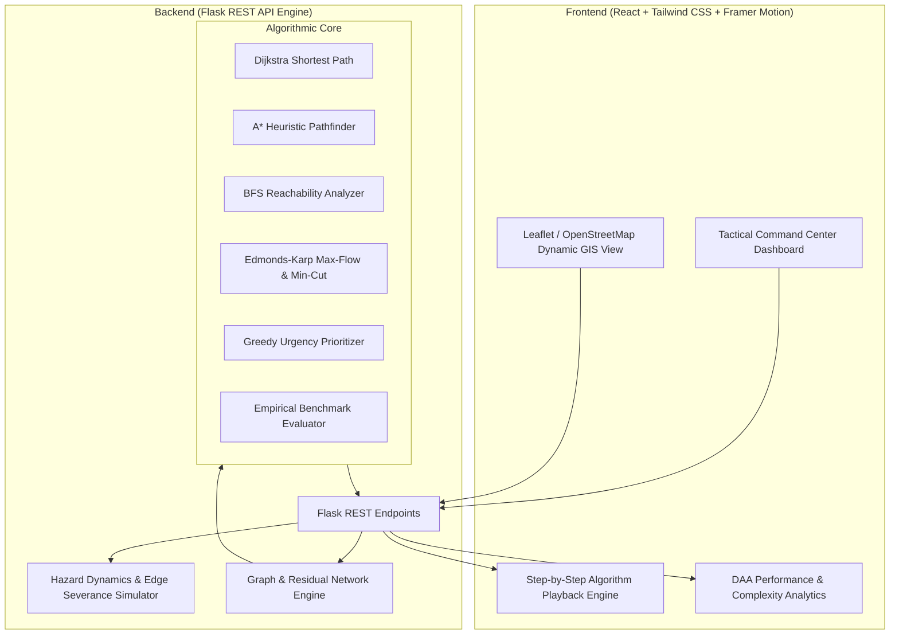

# DisasterShield – Intelligent Disaster Evacuation System
> **Design and Analysis of Algorithms (DAA) Capstone Project**  
> An intelligent command center simulating natural disasters (floods, fires, earthquakes) and calculating optimal multi-shelter evacuation routes, network flow capacities, and road bottleneck mitigations in real time.

---

## 📌 Project Overview
During catastrophic events such as flash floods, uncontrolled wildfires, and seismic earthquakes, standard navigation fails due to rapidly moving hazard zones, collapsed infrastructure, road congestion, and shelter overcapacity. 

**DisasterShield** models a city road network as a capacitated, weighted directed graph $G = (V, E)$, enabling emergency response commanders to simulate hazard progression and execute algorithmic evacuations.

---

## 🧠 Core DAA Algorithms Implemented

| Algorithm | Role in Disaster Evacuation | Theoretical Time Complexity | Theoretical Space Complexity |
| :--- | :--- | :--- | :--- |
| **Dijkstra's Algorithm** | Computes absolute shortest-distance evacuation paths from hazard zones to safe shelters via min-heap priority queue. | $\mathcal{O}((V + E) \log V)$ | $\mathcal{O}(V)$ |
| **A\* Search** | Directs pathfinding toward target shelters using admissible Euclidean/Haversine heuristic $h(n)$, pruning irrelevant search spaces. | $\mathcal{O}(E)$ (best) to $\mathcal{O}(b^d)$ (worst) | $\mathcal{O}(V)$ |
| **Breadth-First Search (BFS)** | Unweighted hop traversal to determine topological reachability, isolated zones, and rapid perimeter discovery. | $\mathcal{O}(V + E)$ | $\mathcal{O}(V)$ |
| **Edmonds-Karp (Max-Flow)** | Formulates evacuation as a Maximum Network Flow problem with road capacities and shelter sink constraints; pinpoints critical road bottlenecks via **Min-Cut Theorem**. | $\mathcal{O}(V \cdot E^2)$ | $\mathcal{O}(V + E)$ |
| **Greedy Prioritization** | Rapid heuristic triage allocating high-urgency zones (proximity to fire/flood + vulnerable populations) to nearest available shelter capacity. | $\mathcal{O}(Z \log Z + Z \cdot S)$ | $\mathcal{O}(V)$ |

---

## 🏛️ System Architecture



---

## 🚀 Quick Start Guide

### Prerequisites
- Python 3.10+
- Node.js v18+ and npm

### 1. Backend Setup
```bash
cd backend
python -m venv venv
# Windows:
venv\Scripts\activate
# Linux/macOS:
source venv/bin/activate

pip install -r requirements.txt
python app.py
```
*Backend runs on `http://localhost:5000`*

### 2. Frontend Setup
```bash
cd frontend
npm install
npm run dev
```
*Frontend runs on `http://localhost:5173`*

---

## 📊 Evaluation & Verification
The platform provides live step-by-step trace visualization and comparative metrics:
- **Execution Time ($\mu s$ / $ms$)**
- **Explored Nodes Count**
- **Total Evacuated Flow vs Network Capacity**
- **Bottleneck Roads (Min-Cut)**
- **Isolated / Unreachable Population Pockets**

---

## 👥 Author
- Developed by **ShriRaam S** ([@shriraam01](https://github.com/shriraam01))
- Repository: [Disaster-Shield](https://github.com/shriraam01/Disaster-Shield)
